<p align="center"></p>

<p align="center"><i>Still sane, exile?</i></p>

<p align="center">
<a href="https://trilink.wispborne.com/open.html?mod=%7B%22url%22%3A%22https%3A%2F%2Fraw.githubusercontent.com%2FExiledPortals%2FExiledSector%2Fmain%2FExiledSector.version%22%2C%22id%22%3A%22exiledSector%22%2C%22version%22%3A%220.1.0%22%7D&dep=%7B%22url%22%3A%22https%3A%2F%2Fraw.githubusercontent.com%2FLazyWizard%2Flazylib%2Fmaster%2Fmod%2Flazylib.version%22%2C%22id%22%3A%22lw_lazylib%22%2C%22version%22%3A%223.0.0%22%7D&dep=%7B%22url%22%3A%22https%3A%2F%2Fraw.githubusercontent.com%2FMagicLibStarsector%2FMagicLib%2Fmaster%2Fmagiclib.version%22%2C%22id%22%3A%22MagicLib%22%2C%22version%22%3A%221.5.6%22%7D&dep=%7B%22url%22%3A%22https%3A%2F%2Fraw.githubusercontent.com%2FLukas22041%2FLunaLib%2Fmain%2FLunaLib.version%22%2C%22id%22%3A%22lunalib%22%2C%22version%22%3A%222.0.5%22%7D"></a>
</p>

<p align="center"><b><a href="https://github.com/ExiledPortals/ExiledSector/releases/latest/download/ExiledSector.zip">Manual download</a></b> | <a href="https://github.com/ExiledPortals/ExiledSector">Source & Changelog (GitHub)</a></p>

## Features

Exiled Sector adds three major modules: a skill tree for every ship, hull upgrades for ships and star charts to go and find more of both. The skill tree, hull upgrades and star charts can each be switched off in LunaLib settings if you'd rather run without them.

### The skill tree

Press the Skill Tree button in the refit screen and every ship in your fleet gets a tree of its own, over 300 nodes of armor, flux, guns and questionable engineering decisions. Ships level up in combat and every level buys a node, so your veteran Lasher eventually stops being a Lasher and starts being a problem. The small nodes along the tree's main paths grant Low Tech, High Tech or Midline affinity, which adds up across the ship into hull, armor, flux and cargo bonuses.

<details>
<summary>The skill tree</summary>

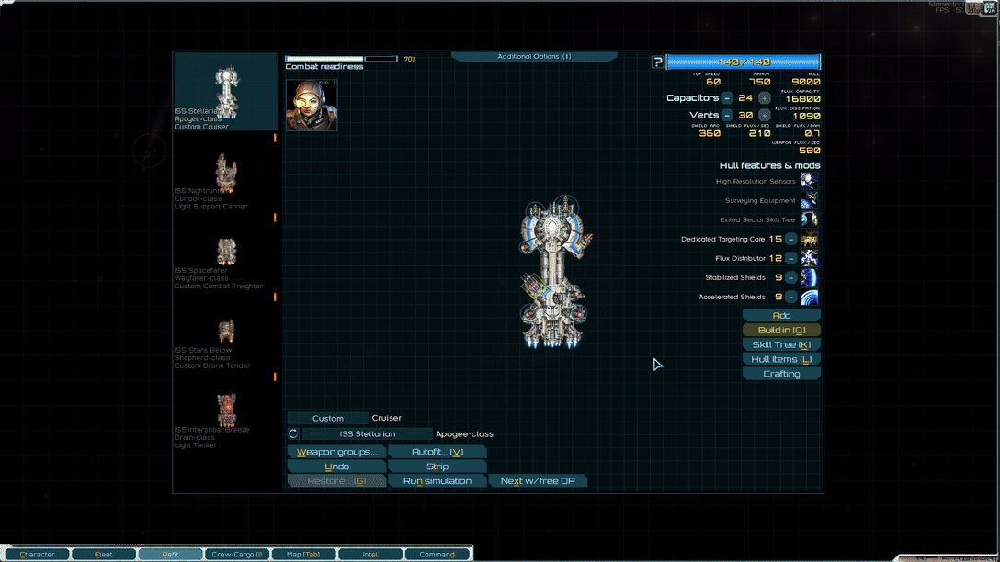

</details>

You might have to travel a bit for the juicy nodes. Slot a Wormhole Anchor into a Subroutine Socket and it tears a hole out past the edge of the tree, to where the sensible nodes stop. Ctrl-click the socket and in you go. Anchors only turn up once you have the Janus Device, unless you allow them earlier in the mod settings. Story-locked areas only drop their anchors once you can open them, except Nightcross, whose anchor is what opens it. An area turned on without its mod, or whose faction Nexerelin has eliminated, has its anchor in salvage and ruins.

<details>
<summary>Travelling through a Wormhole Anchor</summary>

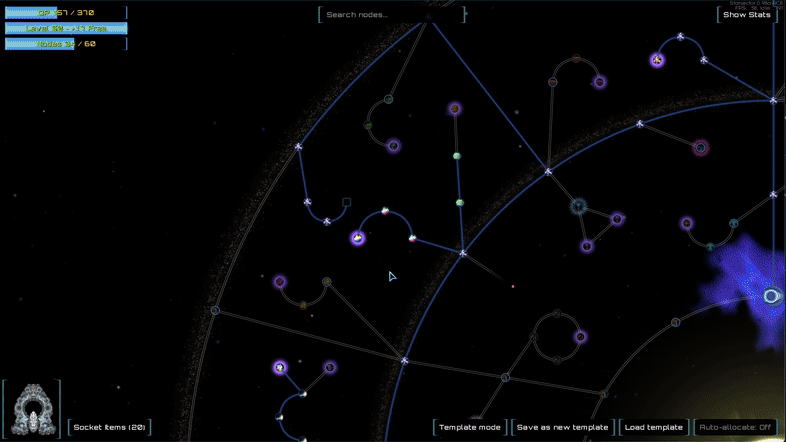

</details>

Every major faction has a volume of its own, full of nodes that think the way it does. The Hegemony thickens your armor, Tri-Tachyon invoices you for it and the Luddic Path would quite like your ship to explode, ideally next to someone else's.

<details>
<summary>Unique faction volume nodes</summary>

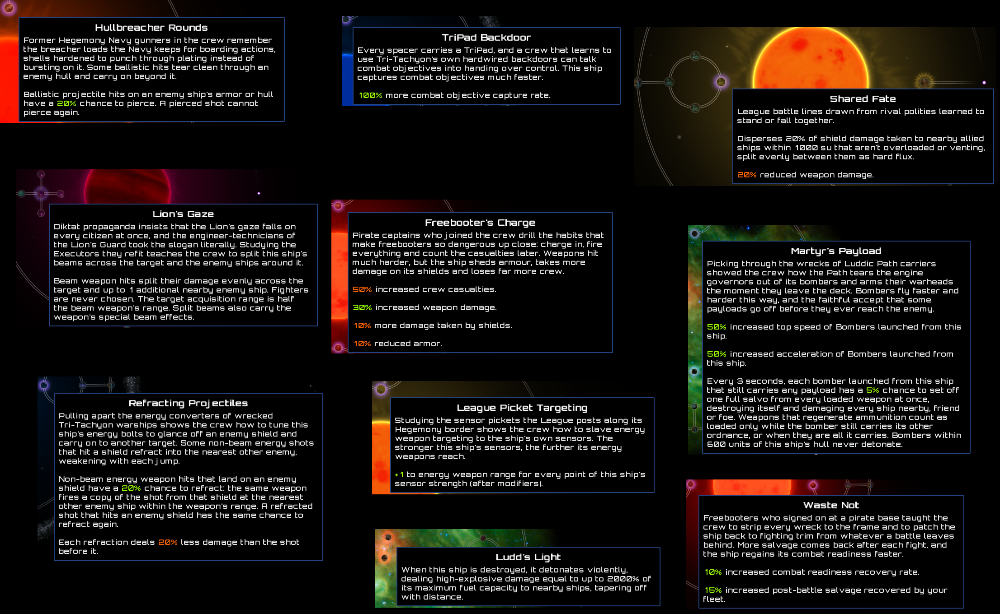

</details>

Doctrine Archives are faction playbooks your crew definitely didn't steal. Some rewrite every node around them into faction-related bonuses, others bolt the doctrine on top. Your engineers read the Tri-Tachyon one and now call the reactor a "growth opportunity".

<details>
<summary>Doctrine Archives</summary>

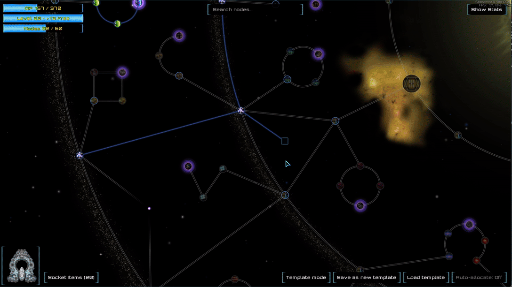

</details>

Running Random Assortment of Things, Nightcross Armory, Navarchy of Tania or LOST_SECTOR? Explore them to find more ways to blow up your enemies.

<details>
<summary>Spoilers: volumes from other mods</summary>

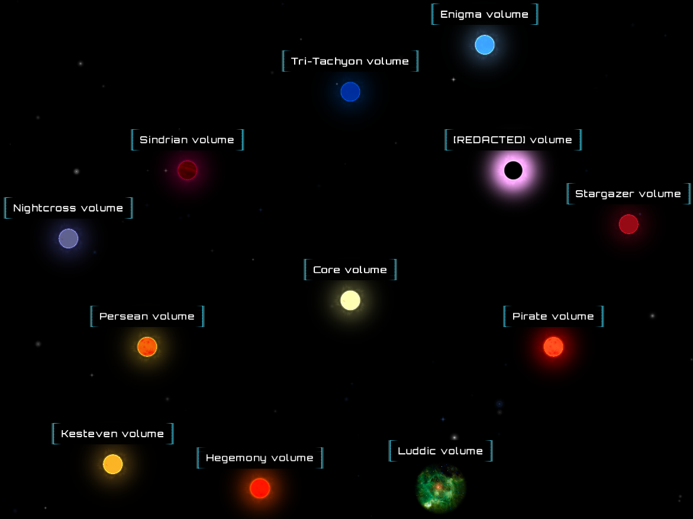

</details>

### Hull upgrades

Nobody has designed a new hull since the Collapse, and the Domain's blueprints sit behind DRM older than your grandmother's grandmother. So your crew looks at other people's ships, decides they had some good ideas and welds those ideas onto yours. 

Every ship starts with one Hull Upgrade point. Spend it on a section of the ship, and that section takes hull items of its own.

By default, Refit Schematics turn up in wrecks and salvage once you reach level 15, and each one takes a ship below its tier straight up to it, from two points for Scrapped to five for Domain.

Switch Hull Upgrade Points to Star Chart Progress in LunaLib settings and every ship gains a point instead as you clear tier 5, 10 and 15 Star Charts.

For a harder game, switch on Require Master Schematics in LunaLib settings. Each ship's skill tree then stays locked until you use a rare Master Schematic on it, and NPC fleets only bring as many trees as you have.

<details>
<summary>Unlocking a section</summary>

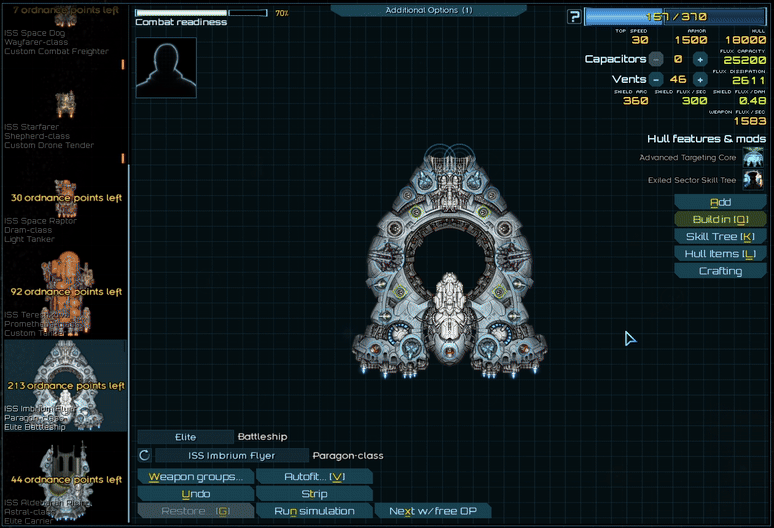

</details>

Hull items come common, rare and unique, rolling prefixes and suffixes the way the Karui ancestors intended.

<details>
<summary>Hull items</summary>

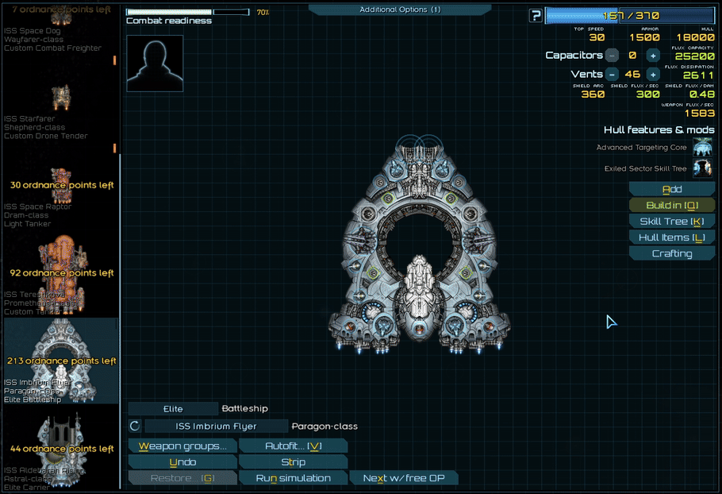

</details>

<details>
<summary>Installing hull items</summary>

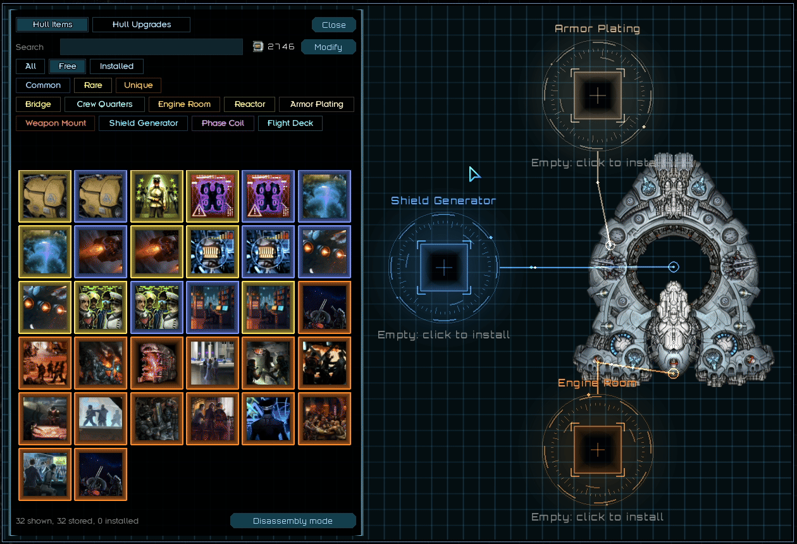

</details>

Don't like the rolls? Find nanoswarms (or grow them from Nanite Feedstock) and set them loose on your items at the crafting bench to add, reroll, reshape or freeze their modifiers. Or corrupt one and find out. Results may vary. Results will vary.

<details>
<summary>The crafting bench</summary>

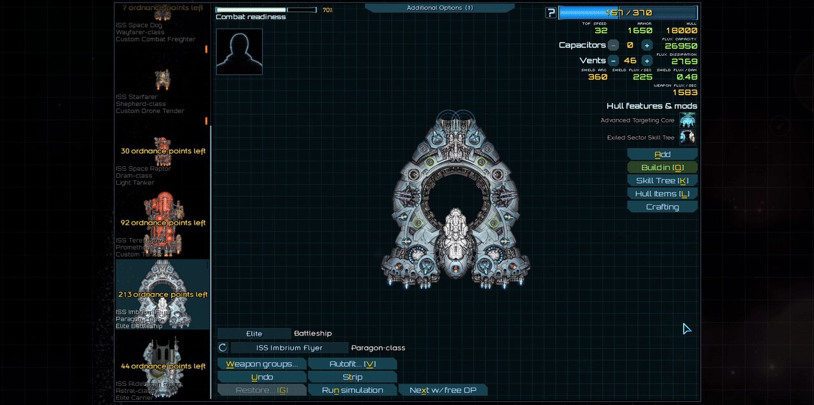

</details>

<details>
<summary>Nanoswarm types</summary>

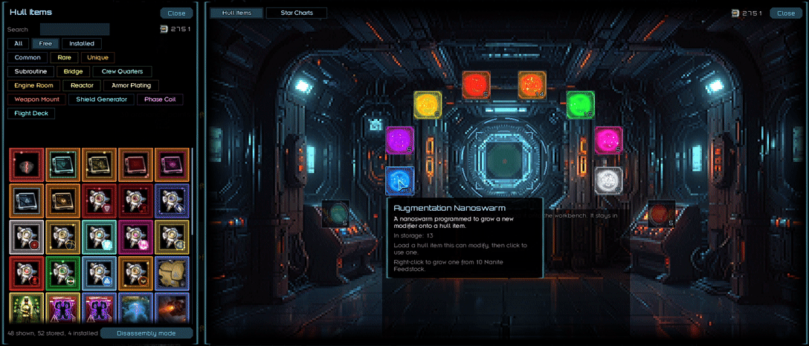

</details>

<details>
<summary>Using nanoswarms</summary>

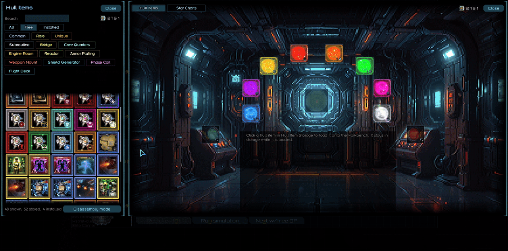

</details>

Note: no Path of Building, but the codex should give you what you need.

The loot turns up everywhere you'd expect it to: research stations, orbital labs, derelicts and the smoking remains of anyone who disagreed with you. The crew gets nothing, as is tradition.

<details>
<summary>LOOOOOOT</summary>

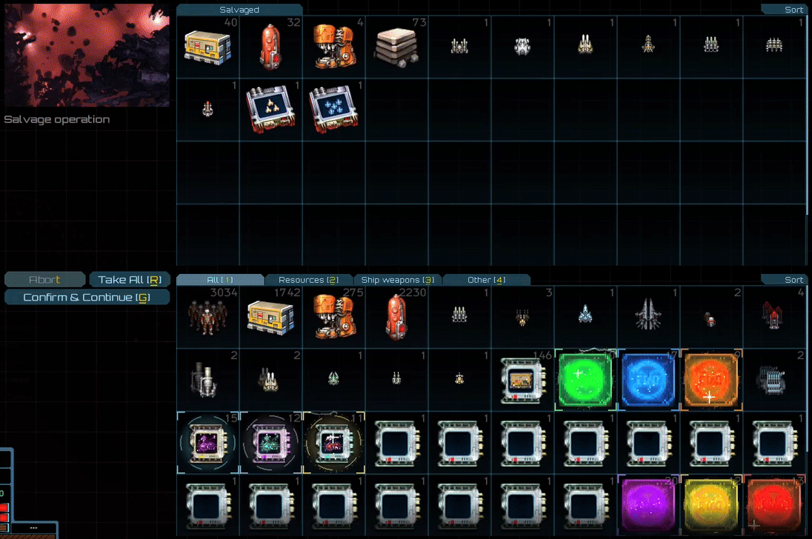

</details>

### Star charts

Star Charts lead to systems no map shows, cut off from hyperspace and guarded by fleets that weren't expecting company. They come in 15 tiers of increasingly poor life choices and turn up on tough enemy fleets and inside other charts, so every run you survive hands you an excuse for a worse one.

To open one you need a Wormhole Gateway, a colony structure for people who have run out of normal places to kill their crew.

Charts roll modifiers too, and the same nanoswarms work on them. Bigger fleets, nastier bosses, better rewards. You asked for this (I think? Maybe it was me that asked for this).

<details>
<summary>Building a Wormhole Gateway and crafting a Star Chart</summary>

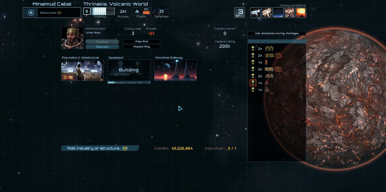

</details>

Open the wormhole, fly in, deal with whoever is home and take everything that isn't bolted down. When the run ends the system goes with it, along with anything you forgot to pick up. No it will not bloat your save (I hope).

## Requirements

- Starsector 0.98a-RC8
- [LazyLib](https://fractalsoftworks.com/forum/index.php?topic=5444.0)
- [MagicLib](https://fractalsoftworks.com/forum/index.php?topic=25868.0)
- [LunaLib](https://fractalsoftworks.com/forum/index.php?topic=25658.0)

Optional:

- Console Commands adds `ExiledSectorGrantFleetXp [amount]`.
- A healthy disregard for vanilla balance.

## Compatibility

> [!WARNING]
> Exiled Sector adds permanent hullmods to the ships in your fleet. It is not safe to remove after being used.

It should be safe to add to an existing save.

Nodes that copy a vanilla hullmod also place the real hullmod on the ship as a phantom: it costs no OP and does nothing itself, but other mods that check for that hullmod see it. That should make most mods work with the tree's nodes without needing dedicated support.

These mods have dedicated compatibility. The version listed is the one I last tested against. Newer versions usually work; if one doesn't, `starsector.log` says so at startup and lists anything Exiled Sector can no longer find.

| Mod | Tested version | What Exiled Sector does with it |
|---|---|---|
| [Second-in-Command](https://fractalsoftworks.com/forum/index.php?topic=30407.0) | 2.0.0 | Its skills see the hullmods your nodes stand in for, and Reconfiguration waives the Converted Hangar penalties. |
| Lost Sector | 0.6.2d, 1.0.b | REDACTED |
| [MagicLib](https://fractalsoftworks.com/forum/index.php?topic=25868.0) | 1.5.6 | Required. A hullmod that tries to strip one of your nodes' hullmods through MagicLib is removed instead. |
| Exotica Technologies | 1.8.7 | The Skill Tree button moves one slot down on the refit screen so it doesn't cover the Exotica button. |
| Random Assortment of Things | 3.3.1 | REDACTED |
| Nightcross Armory | 2.1.6 | REDACTED |
| Navarchy of Tania | 1.3.0 | REDACTED |
| Nexerelin | 0.12.2d | Faction fleets roaming the skill tree count factions in their alliance as allies, so they travel to those volumes too. |
| [GraphicsLib](https://fractalsoftworks.com/forum/index.php?topic=10982.0) | 1.12.1 | Optional. When its lights and distortion are on, many of Exiled Sector's combat effects gain shockwaves, glows, lighting and distortion. The Exiled Sector settings can switch almost all of it off. |

Some weapons from other mods misbehave (often hilariously) when their beams are split, their shots are chained or their shells pierce. These are listed in:

- `data/config/exiledSector/split_beam_effect_blocklist.csv`
- `data/config/exiledSector/energy_chain_blocklist.csv`
- `data/config/exiledSector/ballistic_pierce_blocklist.csv`

All three files are merged across mods, so other mods can opt their own weapons out (or you can opt them back in, at your own risk).

## FAQ

<details>
<summary><b>How do I earn and spend points?</b></summary>

Open a ship's refit screen and click the **Skill Tree** button under the hullmods, or press **K**. If you prefer the old LunaLib Additional Options entry, switch the button off in LunaLib settings.

The first time you open a ship's tree you choose where it starts: Low Tech, Midline or High Tech. The starting node is free. Whenever it is the only node allocated, you can click it again to choose a different start. The other two can still be reached later like any other node.

Every node costs the ship's unused ordnance points: 1 for frigates, 2 for destroyers, 3 for cruisers and 5 for capitals. A node can only be allocated next to one you already have. Node tooltips show only what a node does. Press **F1** while hovering one to also see its restrictions, such as the hullmods and nodes it is mutually exclusive with.

After every engagement, each ship in your fleet gains XP equal to the deployment points of the enemy ships destroyed or disabled, whether it deployed or not. Harder fights grant more: the same battle difficulty bonus vanilla shows before combat multiplies it, up to 6×. Easier fights never reduce it. You get half as much if you lose.

Each level makes your most recently bought node free and refunds its OP. If every node you have is already free, the level is banked, and your next node costs nothing. The first level takes 60 XP, each level after that takes 13% more until level 25 and ships cap at level 50.

Ships that join your fleet late don't start from scratch. No ship in your fleet sits below your own character level, so a ship bought at level 12 starts at level 12 and keeps pace as you level up. Ships behind your highest-level ship also earn 10% more XP for every level they trail it, up to 4×, so they catch up over time. Both can be changed in LunaLib settings.

Click an allocated node to remove it. OP-paid nodes refund their OP, and free nodes return their free allocation. You can't remove a node that other nodes depend on to connect back to your starting point, and you can't remove the starting point itself.

Ctrl-Shift-click an allocated node to remove it along with every node that depends on it, starting with the farthest. Doing this on your starting point clears the whole tree and lets you choose a new start. For now it does nothing if any of those nodes has its own removal condition.

For multi-choice nodes, click to open a dropdown so you can pick an option. Ctrl-click repeats your last choice.

Each ship can have a max of 60 nodes.

Every number in this section can be changed in LunaLib settings.

</details>

<details>
<summary><b>Do I have to build a tree for every ship?</b></summary>

Yes, but you don't have to click through every one. In the skill tree screen, "Save as new template" saves a ship's nodes and the order they were taken in. "Load template" puts that plan on another ship with the same starting point, and with Auto-allocate on, every level-up takes the next template node for you. Template mode lets you plan a template without spending any points. Nodes that cost items are always left for you to allocate.

</details>

<details>
<summary><b>What's the difference between "increases" and "more"?</b></summary>

They're two different kinds of modifier, and they stack very differently. If you've played Path of Exile, it's a similar convention.

Starsector calculates a stat like this:

```java
modified = base + base * percentMod / 100 + flatMod;
modified *= mult;
```

| Tooltip wording | Kind | How it stacks |
|---|---|---|
| "10% **increased** / **reduced** flux capacity" | Percent | All percent bonuses on a stat are **added together** first, including those from vanilla hullmods and skills. |
| "**Increases** flux capacity by 600" | Flat | Added after percent bonuses, so percent bonuses don't scale it. This is different to Path of Exile. |
| "10% **more** / **less** flux capacity" | Multiplier | Applied last, to the total. The tree's multipliers are **added together** first (10% more + 10% more = 20% more; 15% more + 30% less = 15% less), and never go past 100% less. They still multiply with multipliers from vanilla hullmods and skills. |

For example, with a base of 1000 flux capacity:

- Two "10% increased flux capacity" nodes give 1000 × (1 + 0.10 + 0.10) = **1200**.
- Two "10% more flux capacity" nodes give 1000 × (1 + 0.10 + 0.10) = **1200**, applied after everything else.
- "15% increased", "Increases by 600", a +10% hullmod and "20% more" together give (1000 + 250 + 600) × 1.2 = **2220**.

Numbers are green when they help your ship and orange when they hurt it.

</details>

<details>
<summary><b>How do NPC fleets get skill trees?</b></summary>

Every fleet can carry skill trees, your own faction's and your allies' included. Flagships, ships with officers and combat stations always get one, and other ships have a 30% chance; civilian and mothballed ships never do. On the regular star map NPC trees mirror your fleet: each NPC ship picks one of your combat ships at random and gets 80 to 120% of its tree power in nodes.

The mirror stops at a cap. Pirates never pass 15 nodes, faction fleets 25 and AI fleets 35, so a ship you keep levelling eventually outgrows them. Bounty targets climb from their cap toward 25 as bounties get harder, and their flagship gets 3 more. An optional bonus multiplier, off by default, can also make NPC node bonuses grow with your fleet's average tree power, again only up to that fleet's cap. Only bonuses scale: drawbacks stay as written, and campaign stats such as sensors, cargo and burn level don't grow.

Star Chart fleets ignore your fleet when sizing their trees. Tier 1 ships get 26 to 29 nodes, climbing to 47 to 50 at tier 15, and Star Chart Bosses get one more. Higher tiers also bring more and larger fleets, more and better officers and better-quality ships, before the chart's own modifiers add more. Chart fleets have no cap, so if you turn the bonus multiplier on it can reach its full maximum there. All of this, the multiplier included, can be tuned on the **NPC Fleets** tab in LunaLib settings.

NPC ships don't all build the same way. Each faction leans towards its own themes: the Hegemony towards armor and ballistics, Tri-Tachyon towards flux, energy and phase, pirates towards speed and missiles. A ship's own system and defense steer it too. Bonuses to armor, hull, flux, speed and range only partly count once they pass a threshold, on your ships and theirs, so each bonus past the threshold adds less. To skip NPC trees entirely, switch them off on the NPC Fleets tab.

</details>

<details>
<summary><b>How do I unlock hidden nodes?</b></summary>

Hidden nodes show up as sensor ghosts until you unlock them.

Wormholes unlock when you gain access to the Gate network, the same point vanilla does: using the Janus Device at the end of the Galatia Academy storyline.

Wormholes come in linked pairs. Allocate one end and the other end comes free. It costs nothing extra, but it still counts toward your node limit. Removing either end removes both. Ctrl-click any identified wormhole, allocated or not, to jump the camera to the other end.

Hullmod nodes unlock when you learn the matching hullmod blueprint. Neural Interface also unlocks if you have the relevant Neural Link skill.

If you'd rather skip all of this, LunaLib settings can reveal hidden nodes, or switch off each kind of unlock condition.

</details>

<details>
<summary><b>When do Hull Upgrades and Star Charts start?</b></summary>

Exiled Sector is meant as an endgame expansion, so the extra modules wait until the skill tree has had time to sink in. Refit Schematics and unique hull items start dropping once your character reaches level 15. Star Charts need a Wormhole Gateway, which you can only build once you recover the Wormhole Tech Blueprint from the Mothballed Equipment Cache in Limbo, where vanilla hides the first wormhole anchor. With Vaults of Knowledge installed, the blueprint goes into the gateway research instead, and two upgrade researches raise the chart tiers it can open. Hull Upgrades can be switched off in LunaLib settings.

</details>

<details>
<summary><b>How do Star Charts get harder?</b></summary>

Each tier brings more fleets, bigger fleets and better ships, crewed by more and better officers, with the ships themselves further along their skill trees. Every chart is also guarded by a Star Chart Boss, a large fleet that grows with each tier. A chart's modifiers push it further still: some add fleet size, quality or strength, others make the boss bigger. Higher tiers drop more to make up for it, including a small chance of colony items from tier 6.

A few tiers for comparison, with numbers still being balanced:

| | Tier 1 | Tier 4 | Tier 10 | Tier 15 |
|---|---|---|---|---|
| Fleet size (each fleet) | 100 | 160 | 335 | 550 |
| Number of fleets | 2–3 | 3–4 | 5–6 | 6–7 |
| Fleet quality | 30 | 45 | 75 | 100 |
| Ship skill tree level | 26–29 | 31–34 | 40–43 | 47–50 |
| Officer level / extra officers | +0 / +0 | +1 / +1 | +3 / +3 | +5 / +5 |
| Boss fleet size | 180 | 300 | 660 | 1100 |
| Colony item chance | 0 | 0 | 1.5% | 4% |

Battles outside charts drop charts up to tier 6, at a tier set by the strongest NPC ship you beat. Past that you climb from inside: finishing a chart's objective drops another chart, often a tier higher, and chart fleets and salvage drop charts at the chart's own tier.

</details>

<details>
<summary><b>Does it work with faction mods?</b></summary>

Most of it should just work. Nodes that copy a hullmod place the real hullmod on the ship (see Compatibility), so other mods that check for it, such as Second-in-Command, still work. Nexerelin fleets get skill trees like any other NPC fleet. Random Assortment of Things, Nightcross Armory and LOST_SECTOR each have a volume of their own on the tree, unlocked by playing their content. Exiled Sector's loot also drops in other mods' loot pools, such as Industrial.evolution and RAT's Abyss. Mods I haven't tested probably work. If one doesn't, please report it.

</details>

<details>
<summary><b>Can I add my favourite faction to the tree?</b></summary>

Not easily yet. A volume needs placement, circular icons, thematic descriptions, new effect code and a wormhole anchor, and the existing ones have bespoke visuals I'd like to keep. The repo has an editor in `tools/editor`, but the format will change before 1.0. Until then, suggestions and pull requests are welcome, and more faction volumes are coming as mod authors give permission.

</details>

<details>
<summary><b>Can I update mid-run?</b></summary>

Every release on GitHub ends with "Save compatible." or "Not save compatible." If you update, LunaLib keeps your old values for any setting I've rebalanced. Reset the Exiled Sector settings to their defaults in LunaLib to pick up the new ones. When in doubt, load your save, look around and quit without saving.

</details>

<details>
<summary><b>How does this fit into the lore?</b></summary>

The tree isn't your ship gaining sentience and learning kung fu. It's a picture of you and your crew making lots of small changes that pull the ship away from its factory spec: rerouted conduits, flux grids tuned to the captain's habits, armor patched where it keeps getting hit. That's the same thing vanilla's hullmods represent, just in finer steps. A veteran hull that has survived a dozen campaigns shouldn't fly like one fresh off a Domain-era template, and a ship your crew has been iterating on for years is going to be much more familiar to them. They'll learn the ins and outs of its quirks and get every edge they can.

I may also add a node that teaches your ship kung fu.

Exiled Sector is designed to replace the vanilla hullmod system. I wasn't comfortable disabling hullmods entirely, because that would make the mod parasitic and incompatible with the many mods that add their own. Instead, the OP cost and levelling hybrid is meant to make the tree the better deal most of the time. Every hullmod you install is 3–4 nodes you didn't take. Keep a hullmod when its unique effect, probably from another mod, is worth that trade.

</details>

<details>
<summary><b>Why does every ship have its own tree, instead of one for my character?</b></summary>

Overhauls of the character skill system are a well-explored space, and playing nicely with other mods matters to me, so I didn't want to build something that fights Second-in-Command or the other overhaul mods.

A tree per ship also means that finding a cool new ship, at any point in a playthrough, gives you something new to build up.

One of the things I love most about Starsector is losing myself in designing a ship. Hullmods are the least flexible part of vanilla customisation, and I wanted to replace them with something more interesting.

</details>

<details>
<summary><b>What languages is Exiled Sector available in?</b></summary>

Exiled Sector is available in English and Simplified Chinese. By default it follows the game's language, so a Chinese-localised Starsector shows the skill tree in Chinese automatically. You can also pick a language in the LunaLib settings; the change takes effect after a restart.

The skill tree screen always shows the chosen language, using a bundled Noto Sans SC font. Text the game draws itself stays in English unless the game can display Chinese characters.

The Chinese translation is a first draft awaiting review by a native speaker. If any Chinese speakers notice issues, please report them. To add another language, see the [localisation guide](docs/i18n/README.md).

</details>

## Disclaimer

This mod is in early development.

It is my first mod and my first foray into OpenGL/game development, and is by no means feature complete or bug free.

AI usage: I am a Java software engineer working in the regulatory sector where AI use is heavily restricted at this stage. I started this project as a way to educate myself on the capabilities of LLMs for clean, maintainable code, so that when people asked my opinion I can definitively state that LLMs are not the godsend Sam Altman claims. I still think giving inexperienced devs access to an LLM is like giving an 8 year old a powerdrill. Claude's Opus 5.5 was used for this project.

The art in the mod comes from starsector-core, royalty-free sources and other mods whose authors kindly gave permission (see Credits).

I am seeking any feedback, bug reports, node suggestions, or faction designs.

You can find me on various Starsector Discords or by direct message @portals_

## Credits

A big thank you to Lukas04 for letting me build the ExoTech and Abyss areas from Random Assortment of Things, to YukiM for the same in Nightcross Armory, to I Spectros I, whose Navarchy of Tania art the Tania area uses and to Kissa Mies and SirHartley for LOST_SECTOR. The loot alert sounds are from Path of Exile and are copyright Grinding Gear Games. [CREDITS.md](CREDITS.md) lists every borrowed file, who made it and the terms it is used under.

## License

Exiled Sector is licensed under the [GNU General Public License v3.0](LICENSE). Fork it, reuse it, change it; just keep your version open source under the same license. This covers the source code only. Art and sounds borrowed from other mods belong to their authors and are not covered by the GPL; ask them before reusing those files.
