<p align="center">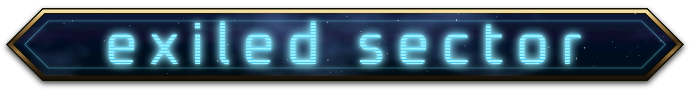</p>

<p align="center"><i>Still sane, exile?</i></p>

<p align="center">
<a href="https://trilink.wispborne.com/open.html?mod=%7B%22url%22%3A%22https%3A%2F%2Fraw.githubusercontent.com%2FExiledPortals%2FExiledSector%2Fmain%2FExiledSector.version%22%2C%22id%22%3A%22exiledSector%22%2C%22version%22%3A%220.1.0%22%7D&dep=%7B%22url%22%3A%22https%3A%2F%2Fraw.githubusercontent.com%2FLazyWizard%2Flazylib%2Fmaster%2Fmod%2Flazylib.version%22%2C%22id%22%3A%22lw_lazylib%22%2C%22version%22%3A%223.0.0%22%7D&dep=%7B%22url%22%3A%22https%3A%2F%2Fraw.githubusercontent.com%2FMagicLibStarsector%2FMagicLib%2Fmaster%2Fmagiclib.version%22%2C%22id%22%3A%22MagicLib%22%2C%22version%22%3A%221.5.6%22%7D&dep=%7B%22url%22%3A%22https%3A%2F%2Fraw.githubusercontent.com%2FLukas22041%2FLunaLib%2Fmain%2FLunaLib.version%22%2C%22id%22%3A%22lunalib%22%2C%22version%22%3A%222.0.5%22%7D"></a>
</p>

<p align="center"><b><a href="https://github.com/ExiledPortals/ExiledSector/releases/latest/download/ExiledSector.zip">Manual download</a></b> | <a href="https://github.com/ExiledPortals/ExiledSector">Source & Changelog (GitHub)</a></p>

## Features

Exiled Sector adds three things: a skill tree for every ship, hull upgrades (basically equipment for ships), and an Atlas of the Outer Reaches: a procedurally generated endgame area full of anomalies and loot to explore. 

Each of them can be disabled in LunaLib settings if they're not to your taste.

### The skill tree

Every ship in your fleet gets its own skill tree: over 400 nodes of questionable engineering decisions. 

You can spend ship OP on nodes, or you can level your ships up in combat. Each ship level grants you one point to spend on the tree. 

Modules on ships and stations share part of their parent tree's effects.

<details>
<summary>The skill tree</summary>

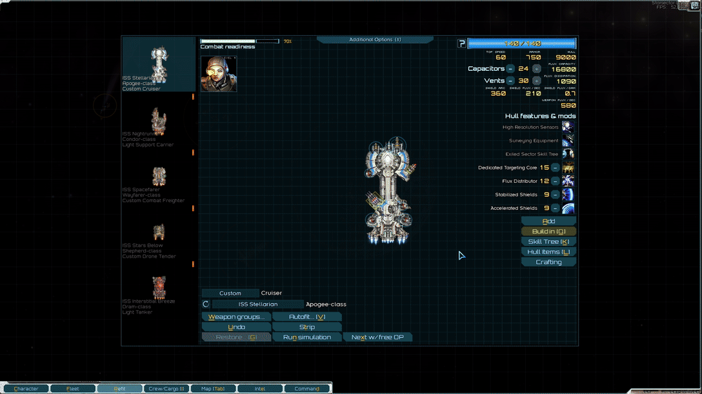

</details>

The core volume of the tree contains mostly replicas of the vanilla hullmods. 

Wormhole Anchors, however, allow your ship to gain access to a variety of unique and powerful modifiers themed around both vanilla and modded factions. 

Anchors start dropping once you have the Janus Device (or earlier if you change that in the mod settings). Story-locked areas only drop their anchor once you've unlocked them. Explore the sector to find out how!

<details>
<summary>Travelling through a Wormhole Anchor</summary>

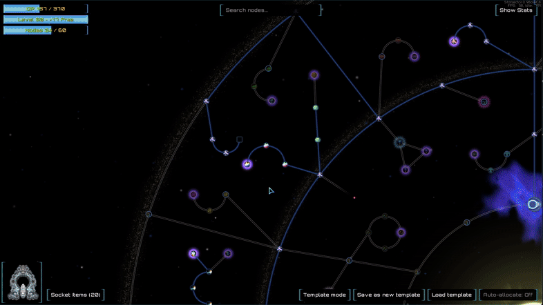

</details>

Every major faction has its own volume, with nodes that suit how that faction fights. The Hegemony gives you more armor, Tri-Tachyon gives you flux and sends you an invoice, and the Luddic Path would like your ship to explode, preferably next to someone else's.

<details>
<summary>Unique faction volume nodes</summary>

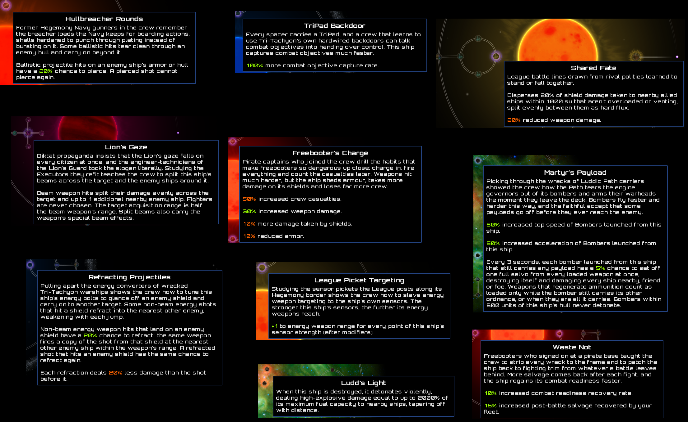

</details>

If you're running Random Assortment of Things, Nightcross Armory, Navarchy of Tania or LOST_SECTOR, they have volumes too.

<details>
<summary>Spoilers: volumes from other mods</summary>

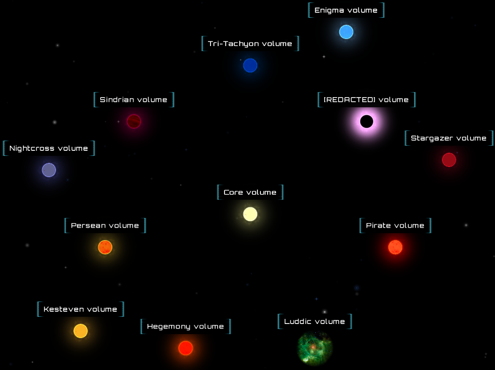

</details>

### Hull upgrades

Nobody has designed a new hull since the Collapse, and the Domain's blueprints are locked behind DRM older than your grandmother's grandmother. So your crew copies the good ideas they find on other people's ships and welds them onto yours.

Every ship starts with one Hull Upgrade point. Spend it on a section of the ship.

Find Refit Schematics (which start dropping once you reach level 15) that can increase the number of sections on your ship.

<details>
<summary>Unlocking a section</summary>

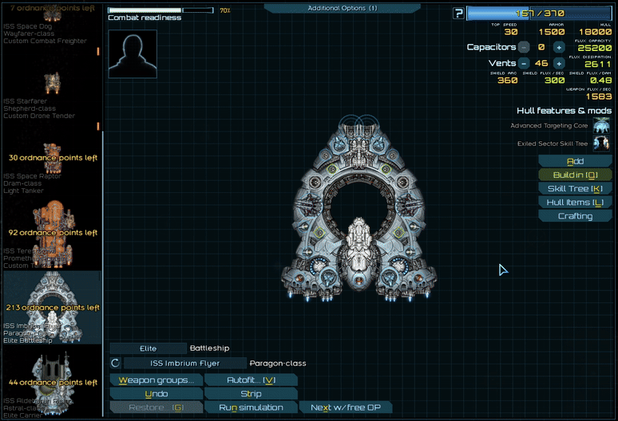

</details>

Hull items come in common, rare and unique, and roll prefixes and suffixes the way the Karui ancestors intended.

<details>
<summary>Hull items</summary>

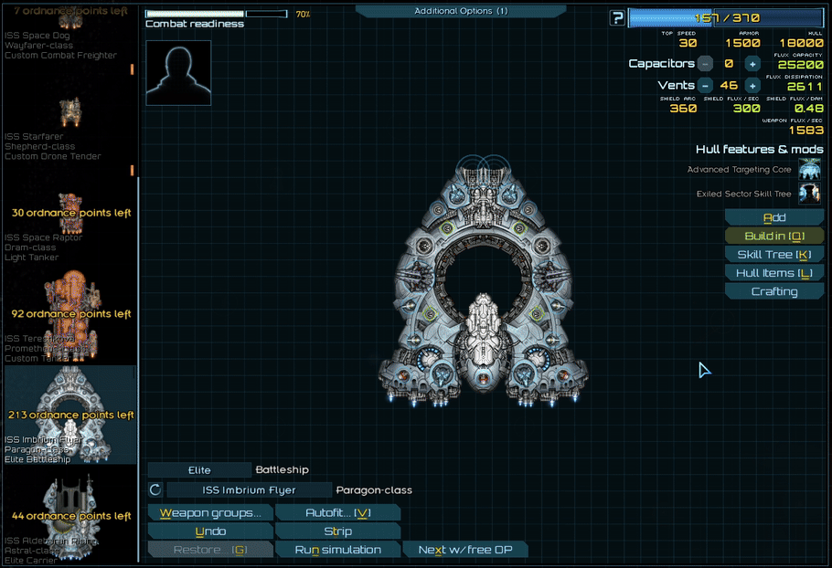

</details>

<details>
<summary>Installing hull items</summary>

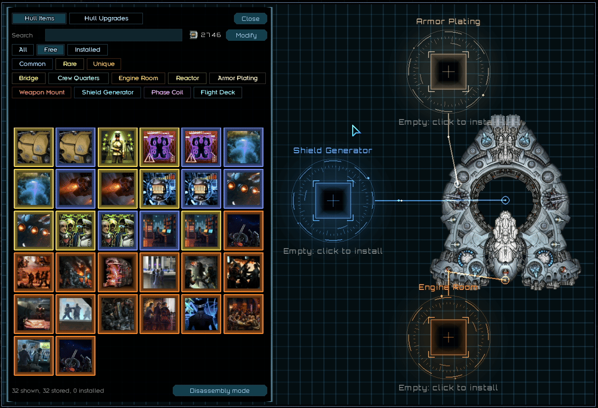

</details>

Bad rolls? Take the item to the crafting bench and use nanoswarms on it to add, remove, reroll, reshape or freeze its modifiers. You can find nanoswarms or grow them from Nanite Feedstock. You can also corrupt an item and see what happens. Results may vary. Results will vary.

<details>
<summary>The crafting bench</summary>

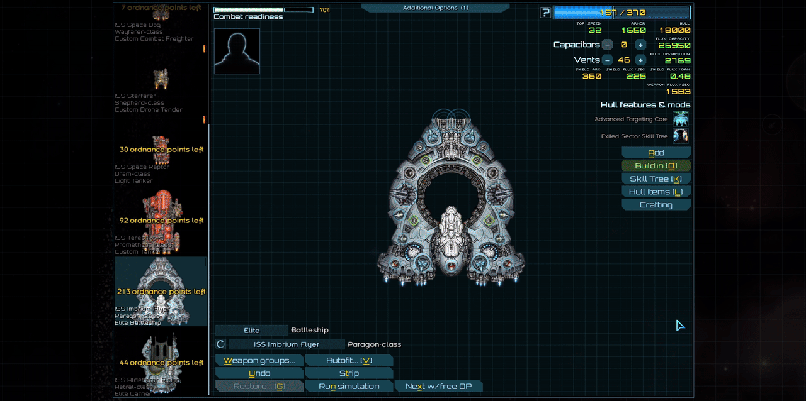

</details>

<details>
<summary>Nanoswarm types</summary>

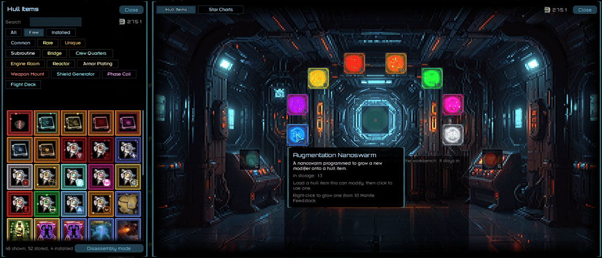

</details>

<details>
<summary>Using nanoswarms</summary>

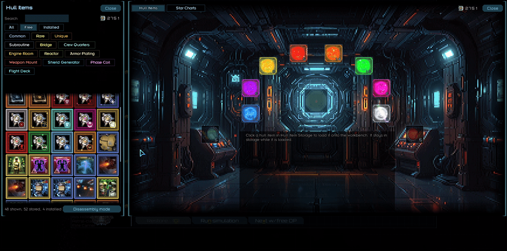

</details>

Note: no Path of Building, but the codex should give you what you need.

Loot drops where you'd expect: research stations, orbital labs, derelicts and the wrecks of anyone who disagreed with you. The crew gets nothing, as is tradition.

<details>
<summary>LOOOOOOT</summary>

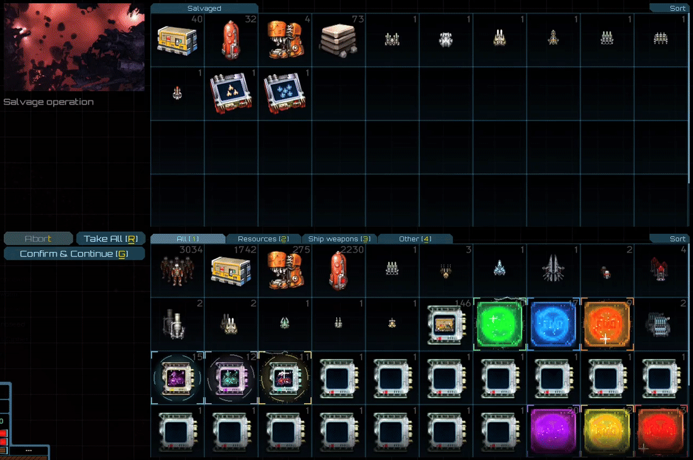

</details>

### Star charts

Star Charts take you to systems outside the sector, cut off from hyperspace and full of fleets that weren't expecting visitors. There are 15 tiers and each one is worse than the last.

To open one you need a Wormhole Gateway, a colony structure for when you've run out of normal places to get your crew killed. 

The gateway opens the Outer Reach Atlas, a map of the systems past the edge of the sector. That's where you craft charts and choose which system each one leads to.

If you don't want to build a colony, turn on No Colony Requirement in LunaLib settings and you can open the atlas from anywhere.

<details>
<summary>Opening the Outer Reach Atlas</summary>

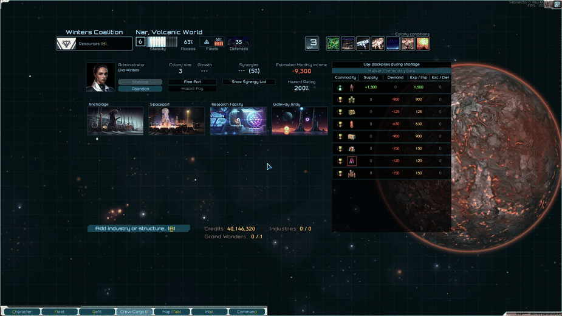

</details>

Each atlas system has a faction and a biome, and can have any of 20 anomalies that change what you'll find there. Atlas Catalysts only drop inside charts, and they add anomalies to a system or give it to a different faction. 

Charts roll modifiers too, and the same nanoswarms work on them. The modifiers make fleets bigger and bosses nastier, and the rewards better. You asked for this (I think? Maybe it was me that asked for this).

<details>
<summary>Inspecting an atlas system</summary>

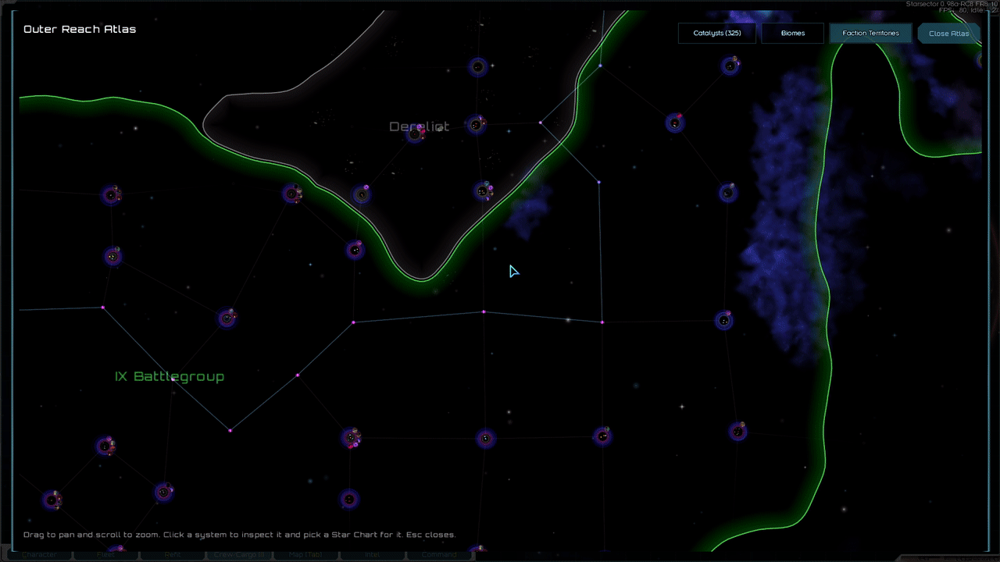

</details>

<details>
<summary>Crafting a Star Chart</summary>

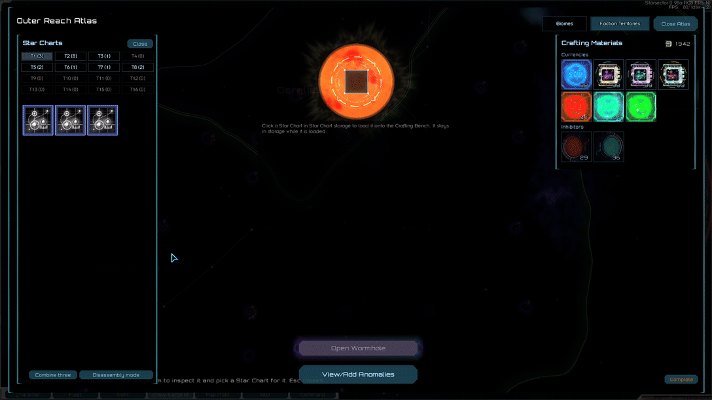

</details>

Open the wormhole, fly in, kill whoever lives there and take everything that isn't bolted down. The chart is complete once the boss's flagship or station is destroyed. When the run ends the system is deleted, along with anything you forgot to pick up. No it will not bloat your save (I hope).

## Requirements

- Starsector 0.98.5a (0.98a-RC8 also works)
- [LazyLib](https://fractalsoftworks.com/forum/index.php?topic=5444.0)
- [MagicLib](https://fractalsoftworks.com/forum/index.php?topic=25868.0)
- [LunaLib](https://fractalsoftworks.com/forum/index.php?topic=25658.0)

Optional:

- Console Commands: adds a bunch of different useful commands.
- A healthy disregard for vanilla balance.

## Compatibility

> [!WARNING]
> Exiled Sector adds permanent hullmods to the ships in your fleet. It is not safe to remove after being used.

It should be safe to add to an existing save.

Nodes that copy a vanilla hullmod also put the real hullmod on the ship as a phantom. It costs no OP and does nothing by itself, but other mods that look for that hullmod will find it, so most mods should work with the tree without needing special support.

The mods below have specific compatibility work. The version listed is the last one I tested. Newer versions usually work, and if one doesn't, `starsector.log` will say so at startup and list what Exiled Sector couldn't find.

| Mod | Tested version | What Exiled Sector does with it |
|---|---|---|
| [Second-in-Command](https://fractalsoftworks.com/forum/index.php?topic=30407.0) | 2.1.1 | Its skills recognise the hullmods your nodes replace, and Reconfiguration removes the Converted Hangar penalties. |
| Lost Sector | 0.6.2d, 1.0.b | REDACTED |
| [MagicLib](https://fractalsoftworks.com/forum/index.php?topic=25868.0) | 1.5.6 | Required. If a hullmod tries to remove one of your nodes' hullmods through MagicLib, that hullmod gets removed instead. |
| Exotica Technologies | 1.8.7 | The Skill Tree button moves down one slot on the refit screen so it doesn't cover the Exotica button. |
| Random Assortment of Things | 3.3.1 | REDACTED |
| Nightcross Armory | 2.1.7 | REDACTED |
| Nexerelin | 0.12.2d | The faction fleets that fly around the skill tree also visit the volumes of factions they're allied with. |
| [GraphicsLib](https://fractalsoftworks.com/forum/index.php?topic=10982.0) | 1.12.2 | Optional. With its lighting and distortion turned on, a lot of the combat effects get shockwaves, glows, lights and distortion. You can turn almost all of it off in the Exiled Sector settings. |
| Secrets of the Frontier | 0.15.1 | Its scripted story fights don't drop any salvage, so they don't drop Exiled Sector loot either. |
| DIY Planets | 1.0.30 | Its bar quests won't put their stations inside a Star Chart, where they'd be deleted when the chart closes. |

Some modded weapons break (often hilariously) when their beams get split, their shots chain or their shells pierce. Those weapons are listed in:

- `data/config/exiledSector/split_beam_effect_blocklist.csv`
- `data/config/exiledSector/energy_chain_blocklist.csv`
- `data/config/exiledSector/ballistic_pierce_blocklist.csv`

All three files merge across mods, so other mods can add their own weapons to them (and you can take weapons back out, at your own risk).

Many nodes put a vanilla hull mod on the ship, such as Shield Conversion - Omni or Integrated Targeting Unit. If a hull mod in your mod removes or blocks vanilla hull mods, add it to `data/config/exiledSector/hullmod_conflicts.csv` in your mod. Put your hull mod id in the `hullmod` column, the vanilla ids it conflicts with in `conflicts` (separated by `;`), and whatever you like in `notes`. Ships with your hull mod will then never get those nodes, NPC ships included, and the node tooltips will show the conflict. The file merges across mods by the `hullmod` column, so your row replaces any row Exiled Sector has for the same hull mod.

```
hullmod,conflicts,notes
my_frontal_emitter,frontemitter; adaptiveshields; extendedshieldemitter,My Mod
```

## FAQ

<details>
<summary><b>How do I earn and spend points?</b></summary>

Open a ship's refit screen and click the **Skill Tree** button under the hullmods, or press **K**. If you prefer the old LunaLib Additional Options entry, turn the button off in LunaLib settings.

The first time you open a ship's tree you pick its starting point: Low Tech, Midline or High Tech.

Nodes initially cost 1/2/3/5 unused ordnance points based on hull size (by default).

After each battle, every ship in your fleet gets XP based on the deployment points of the enemy ships destroyed or disabled, whether it was deployed or not. Harder fights give more XP. If you lose, you get half.

Each level makes the last node you allocated free and refunds any spent OP. If all your nodes are already free, the level is saved so your next node costs nothing.

New ships don't start from zero. A ship's level is never lower than your character level, so a ship you buy or recover at level 12 starts at level 12. Ships below your highest-level ship also get 10% more XP for each level they're behind, up to 4×. You can change both of these in LunaLib settings.

Ctrl-Shift-click an allocated node to remove it and every node that depends on it. Doing this on your starting node clears the whole tree and lets you pick a new start.

Ctrl-Shift-click an unallocated node to take the shortest path to it. The path goes through wormholes if that's shorter, and stops if you run out of OP or nodes. Multi-choice nodes along the way use your last choice, or what you picked on an earlier node of the same kind, or a random option if there's neither. If the node can only be reached through a wormhole, a spare Wormhole Anchor for it goes into the nearest Subroutine Socket, and the socket is allocated first if needed.

</details>

<details>
<summary><b>Do I have to build a tree for every ship?</b></summary>

Yes, but templates and the ctrl + shift + click save you most of the busywork. The skill tree screen's "Save" button saves a ship's nodes and the order you took them in. "Load" puts that plan on another ship. A ship with a different starting point first takes the shortest route to the template. If Auto-allocate is on, each level-up takes the next node in the template for you. Template mode lets you plan a template without spending points. Templates are shared by every save and kept in saves/common/exiledSector_skillTreeTemplates.json.data, which the game re-reads whenever the skill tree opens, so outside planners can read and write them while the game runs.

</details>

<details>
<summary><b>What's the difference between "increases" and "more"?</b></summary>

They're two different kinds of modifier, and they stack very differently. If you've played Path of Exile, it's a similar convention.

Starsector calculates a stat like this:

```java
modified = base + base * percentMod / 100 + flatMod;
modified *= mult;
```

| Tooltip wording | Kind | How it stacks |
|---|---|---|
| "10% **increased** / **reduced** flux capacity" | Percent | All percent bonuses on a stat are **added together** first, including those from vanilla hullmods and skills. |
| "**Increases** flux capacity by 600" | Flat | Added after percent bonuses, so percent bonuses don't scale it. This is different to Path of Exile. |
| "10% **more** / **less** flux capacity" | Multiplier | Applied last, to the total. The tree's multipliers are **added together** first (10% more + 10% more = 20% more; 15% more + 30% less = 15% less), and can't go past 100% less. They still multiply with multipliers from vanilla hullmods and skills. |

For example, with a base of 1000 flux capacity:

- Two "10% increased flux capacity" nodes give 1000 × (1 + 0.10 + 0.10) = **1200**.
- Two "10% more flux capacity" nodes give 1000 × (1 + 0.10 + 0.10) = **1200**, applied after everything else.
- "15% increased", "Increases by 600", a +10% hullmod and "20% more" together give (1000 + 250 + 600) × 1.2 = **2220**.

Numbers are green when they help your ship and orange when they hurt it.

</details>

<details>
<summary><b>How do NPC fleets get skill trees?</b></summary>

All fleets, enemies or allies, can have skill trees on their ships. Flagships, ships with officers and stations always get one, and other combat ships sometimes do.

Outside Star Charts, NPC trees grow with your fleet. LunaLib can cap them by fleet type (15 nodes for pirates, 25 for faction fleets and 35 for AI fleets), off by default. Star Chart fleets go by tier instead, from 26 nodes at tier 1 to 50 at tier 15. Each faction builds towards its own style, so the Hegemony goes for armor and Tri-Tachyon for flux.

You can tune all of this, or turn it off, on the **NPC Fleets** tab in LunaLib settings.

</details>

<details>
<summary><b>How do I unlock hidden nodes?</b></summary>

Hidden nodes show up as sensor ghosts until you unlock them.

Wormholes unlock when you get access to the Gate network, which is when you use the Janus Device at the end of the Galatia Academy story.

Wormholes come in pairs. Take one end and you get the other end for free, though it still counts toward your node limit. Removing either end removes both. Right-click any identified wormhole to jump the camera to the other end.

Hullmod nodes unlock when you learn the matching hullmod blueprint. Neural Interface also unlocks if you have the relevant Neural Link skill.

If you'd rather skip all of this, you can reveal hidden nodes or turn off each kind of unlock in LunaLib settings.

</details>

<details>
<summary><b>When do Hull Upgrades and Star Charts start?</b></summary>

Both are meant for the late game. Refit Schematics and unique hull items start dropping at level 15. Star Charts need a Wormhole Gateway, which you unlock by finding its blueprint in Limbo, or through research if you have Vaults of Knowledge.

</details>

<details>
<summary><b>How do Star Charts get harder?</b></summary>

Each tier has more fleets, bigger fleets, better ships, more and better officers, and ships further along their skill trees. Every chart also has a Star Chart Boss, either a large fleet or a station, which gets stronger each tier. Chart modifiers can make it harder again, by adding fleet size, quality or strength or by making the boss bigger. Higher tiers drop more loot to make up for it, including a small chance of colony items from tier 6.

Some example tiers (the numbers are still being balanced):

| | Tier 1 | Tier 4 | Tier 10 | Tier 15 |
|---|---|---|---|---|
| Fleet size (each fleet) | 200 | 320 | 670 | 1100 |
| Number of fleets | 4–6 | 6–8 | 10–12 | 13–14 |
| Fleet quality | 60 | 90 | 150 | 200 |
| Ship skill tree level | 26–29 | 31–34 | 40–43 | 47–50 |
| Officer level / extra officers | +0 / +0 | +2 / +2 | +6 / +6 | +10 / +10 |
| Boss fleet size | 720 | 1200 | 2640 | 4400 |
| Colony item chance | 0 | 0 | 0.3% | 0.8% |

Battles outside charts drop charts up to tier 6, based on the strongest NPC ship you beat. To go higher you have to work your way up from inside the charts. Killing a chart's boss drops another chart, often one tier higher, and chart fleets and salvage drop charts of the same tier.

</details>

<details>
<summary><b>Does it work with faction mods?</b></summary>

Most of it should just work. Nodes that copy a hullmod put the real hullmod on the ship (see Compatibility), so mods that check for it, like Second-in-Command, still see it. Nexerelin fleets get skill trees like any other NPC fleet. Random Assortment of Things, Nightcross Armory, Navarchy of Tania and LOST_SECTOR each have their own volume on the tree, unlocked by playing their content. Exiled Sector loot also shows up in other mods' loot pools, such as Industrial.evolution and RAT's Abyss. Mods I haven't tested will probably work, but if one doesn't, please report it.

</details>

<details>
<summary><b>Can I add my favourite faction to the tree?</b></summary>

Not easily yet. Each volume needs a spot on the tree, circular icons, descriptions, new effect code and a wormhole anchor, and the existing ones have custom visuals I'd like to keep. There's an editor in `tools/editor`, but the format will change before 1.0. Suggestions and pull requests are welcome in the meantime, and I'll add more faction volumes as mod authors give permission.

</details>

<details>
<summary><b>Can I update mid-run?</b></summary>

Every GitHub release ends with "Save compatible." or "Not save compatible." When you update, LunaLib keeps your old values for any settings I've rebalanced, so reset the Exiled Sector settings to default in LunaLib to get the new ones. If you're not sure, load your save, have a look around and quit without saving.

</details>

<details>
<summary><b>How does this fit into the lore?</b></summary>

Your ship isn't gaining sentience and learning kung fu. The tree is you and your crew making lots of small changes to the ship over time, like rerouting conduits, tuning the flux grid to how the captain flies and patching the armor where it keeps getting hit. 

Vanilla hullmods are the same kind of thing, just in bigger steps. A hull that has survived a dozen campaigns shouldn't fly the same as one fresh off a Domain-era template, and a crew that has worked on the same ship for years knows all its quirks and how to get the most out of it.

I may also add a node that teaches your ship kung fu.

Exiled Sector is meant to replace vanilla hullmods. I didn't want to disable hullmods entirely, because that would make the mod parasitic and break the many mods that add their own. Instead, the mix of OP costs and levelling should make the tree the better choice most of the time. Every hullmod you install is 3–4 nodes you didn't take, so keep one when it does something unique (probably from another mod) that's worth it.

</details>

<details>
<summary><b>Why does every ship have its own tree, instead of one for my character?</b></summary>

There are already plenty of character skill overhauls, and I want Exiled Sector to play nicely with other mods, so I didn't want to build something that competes with Second-in-Command or the other overhauls.

A tree per ship also means that finding a cool new ship at any point in a playthrough gives you something new to build up.

One of the things I love most about Starsector is losing myself in designing a ship. Hullmods are the least flexible part of vanilla customisation, and I wanted to replace them with something more interesting.

</details>

<details>
<summary><b>What languages is Exiled Sector available in?</b></summary>

English and Simplified Chinese. It follows the game's language by default, or you can pick one in LunaLib settings.

The Chinese translation is a first draft written by an LLM, so if you speak Chinese and spot problems, please let me know. To add another language, see the [localisation guide](docs/i18n/README.md).

</details>

## Disclaimer

This mod is in early development.

It is my first mod and my first foray into OpenGL/game development, and is by no means feature complete or bug free.

AI usage: I am a Java software engineer working in the regulatory sector where AI use is heavily restricted at this stage. I started this project as a way to educate myself on the capabilities of LLMs for clean, maintainable code, so that when people asked my opinion I can definitively state that LLMs are not the godsend Sam Altman claims. I still think giving inexperienced devs access to an LLM is like giving an 8 year old a powerdrill. Claude's Opus 5.5 was used for this project.

The art in the mod comes from starsector-core, royalty-free sources and other mods whose authors kindly gave permission (see Credits).

I am seeking any feedback, bug reports, node suggestions, or faction designs.

You can find me on various Starsector Discords or by direct message @portals_

## Credits

A big thank you to Spectros for his help and permission to create the Navarchy of Tania volume, to Lukas04 for letting me build the Exo-Tech and Abyss volumes from Random Assortment of Things, to YukiM for the same in Nightcross Armory and to Kissa Mies and SirHartley for LOST_SECTOR. The loot alert sounds are from Path of Exile and are copyright Grinding Gear Games. [CREDITS.md](CREDITS.md) lists every borrowed file, who made it and the terms it's used under.

## License

Exiled Sector is licensed under the [GNU General Public License v3.0](LICENSE). You can fork it, reuse it and change it, as long as your version stays open source under the same license. This only covers the source code. Art and sounds from other mods belong to their authors and aren't covered by the GPL, so ask them before reusing those files.
