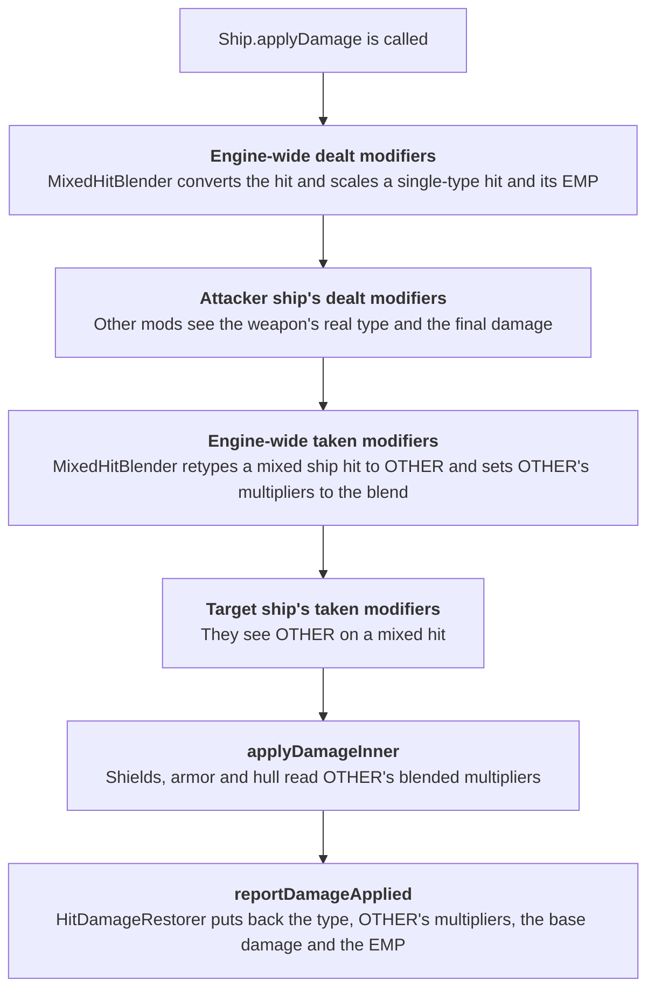

# Mixed Damage Hits

How Exiled Sector makes one Starsector hit carry several damage types at once, without patching the engine. Written for modders whose damage listeners run next to it. Classes are in `exiledsector.skills.skilleffect`; engine behaviour was confirmed by decompiling 0.98a-RC8.

## 1. What it does

Vanilla gives every hit exactly one `DamageType`. Exiled Sector has partial conversions such as "40% of kinetic damage is converted to high explosive damage", so a 100 kinetic shot has to land as one hit of 60 kinetic and 40 high explosive: one armor check at full hit strength, one report, one set of listeners.

Conversions follow Grim Dawn's rules:

- All conversions are worked out once, at the same time, from the hit's original split. Converted damage is never converted again.
- Conversions from one source that add up past 100% are scaled down in proportion.
- Bonuses apply to each type after conversion. Converted damage keeps none of its old type's bonuses.

## 2. The OTHER carrier

The engine reads `DamageType.getShieldMult()`, `getArmorMult()` and `getHullMult()` live on every hit, and the enum has public setters for them. So for the length of one mixed hit, Exiled Sector retypes the hit to OTHER and sets OTHER's three multipliers to the share-weighted blend of the real types, including the target's per-type resistances:

```
shield = sum of share(t) × scale(t) × shieldMult(t) × ShieldDamageTaken(t)
armor  = sum of share(t) × scale(t) × armorMult(t)  × DamageTaken(t)
hull   = sum of share(t) × scale(t) × hullMult(t)   × DamageTaken(t)
```

A hit that is 60% kinetic and 40% high explosive, with no bonuses or resistances, gets shield 1.4, armor 1.1 and hull 1.0. Everything is put back when the hit reports.

OTHER is the carrier because nothing deals OTHER damage from inside a hit, and OTHER has no per-type stats for the engine to add on top. A real type as the carrier would leak the blend into any other hit of that type dealt during the same call.

## 3. One hit, start to finish

`MixedHitBlender` is registered engine-wide as both a dealt and a taken modifier, so its work falls into the engine's own stages:



Exiled Sector's listeners never change a hit directly. Each implements `HitMix.Resolver` and files requests (`convert`, `convertEmp`, `increase`, `more` and so on). The first reader of a hit runs every resolver once and applies them all together, so listener order doesn't matter, and every later reader gets the same cached result.

## 4. Conversion and scaling

A hit is split into six portions: one per damage type, plus EMP. Every conversion reads the original amounts:

```
moved = original[source] × share × (claimed > 1 ? 1 / claimed : 1)
```

Here `claimed` is the sum of all conversion shares from that source. For example, 70% kinetic to high explosive plus 50% kinetic to energy claims 120%, so 100 kinetic becomes 58.3 high explosive and 41.7 energy.

The engine already applies the hit's damage modifier. Per-type increases have to add to the generic increases in that modifier, not multiply with them, so each type gets this extra factor:

```
G         = base × (1 + percent mods / 100) + flat mods
factor(t) = (G + increased(t) / 100) / G × more(t)
```

With 60% generic increased damage and 20% increased kinetic damage, the kinetic factor is `1.8 / 1.6`, and the engine's own 1.6 brings it to 1.8. EMP is its own portion with its own bonuses.

A single-type ship hit gets the factor on its base damage. A mixed ship hit gets it inside the blend. Missiles and other non-ship targets get it as a damage modifier mult that the engine removes after the hit.

## 5. Example: a mixed shield hit


In the engine this is one OTHER hit with 150 base damage. Each type's factor and shield multiplier sit inside OTHER's blended shield multiplier.

## 6. EMP-only arcs

An arc with 0 damage skips every damage modifier, so the blender never sees it. `EmpArcLandings`, an engine entity that advances before the arcs, handles these instead. It reads the arc's private fields (`source`, `empTargetEntity`, `damAmount`, `empDamAmount`, `didDamage`), converts and scales the EMP, and lands the results in the same frame:

- If the arc's EMP only grows, or it hits a shield, the arc lands itself and only the difference is applied beside it.
- Otherwise the arc is stopped and replaced by its leftover EMP and each converted damage type, as separate hits with the arc as the parameter.
- If the fields can't be read, the arc's EMP bonus lands as a hit on the next frame and its EMP stays unconverted.


The arc's EMP drops below its own 400, so it is stopped and replaced by two hits.

## 7. What other mods will see

- Attacker-side dealt modifiers see the weapon's real type and the converted, scaled damage, so lifesteal and charge counters count the final damage.
- Target-side taken modifiers and damage listeners see OTHER on a mixed hit. A type switch takes its default branch, and a fragmentation check never matches.
- Reading `damage.getType().getShieldMult()` (or the armor or hull multiplier) during a hit gives the blend, which is correct.
- Changes another mod makes to a hit's damage or EMP during the hit are kept: Exiled Sector undoes only its own edits, keeping outside changes as a ratio.
- Damage another mod deals from inside a hit with `damage.getType()` inherits the mix if it lands synchronously, and lands as plain OTHER (1 / 1 / 1) if it lands later.
- Detailed Combat Results skips OTHER results, so mixed hits are missing from its after-battle tables.

Other mods shouldn't cache `DamageType` multipliers during combat or call their setters: they are global, and Exiled Sector puts the defaults back every frame.

## 8. Cleanup and limits

- Open mixed hits sit on a stack, so hits dealt from inside a hit close in order. A combat plugin puts every multiplier back at the start of each frame, and a hit left open from an earlier frame is reset before the next hit lands. A stuck blend lasts one hit at most.
- Beams keep their damage object between hits, so off-ship beam hits are retyped to their largest share instead of blended.
- A mixed hit is stronger against armor than two split hits of the same total, because it keeps its full hit strength. This is intended.
- The approach needs the engine to keep reading the `DamageType` getters live, and the arc handling needs those five private fields. If either changes in a future version, mixed hits or arc conversion stop working, and the single-type paths keep working.
